# StudySlot — Assignment 3: Load Balancing and Observability

Enterprise Software Development, Fall 2026 · Widad Fatima Khan

This assignment runs three replicas of StudySlot (the study-room booking
service from A1/A2) behind Envoy, balances both the HTTP API and the gRPC
service, and uses the A1/A2 observability stack to explain the results.
Commands are in the [README](README.md); earlier reports are in
[docs/a1](docs/a1/REPORT.md) and [docs/a2](docs/a2/REPORT.md). 

---

## Part A — Replicas and routing

### A.1 Architecture

A2 ran HTTP and gRPC in separate containers. Here each replica is **one
process**: Uvicorn serves HTTP on 8000 and starts the gRPC server on 50051.
Compose runs three copies (`deploy.replicas: 3`). Envoy took over A2's ports,
so every A2 caller works unchanged: the "layered system" constraint from A2,
now in use.

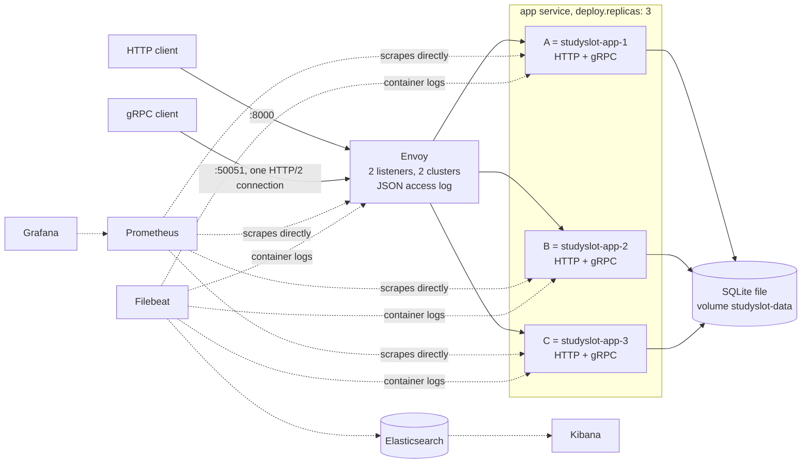

| Setting | Choice |
|---|---|
| Listeners | `:8000` and `:50051`, both HTTP connection managers (layer 7); the gRPC one speaks HTTP/2 |
| Clusters | `studyslot_http`, `studyslot_grpc`: replicas by container name, re-resolved through Docker's DNS every second |
| Part A destinations | A only; B and C running with no traffic (Envoy's `/clusters` lists only `studyslot-app-1`) |
| Retries / circuit breakers | No retry policy; circuit-breaker limits raised to 1,000,000 |
| Configs | All six variants generated by `scripts/envoy_config.py`, so runs differ only in what each experiment changes |

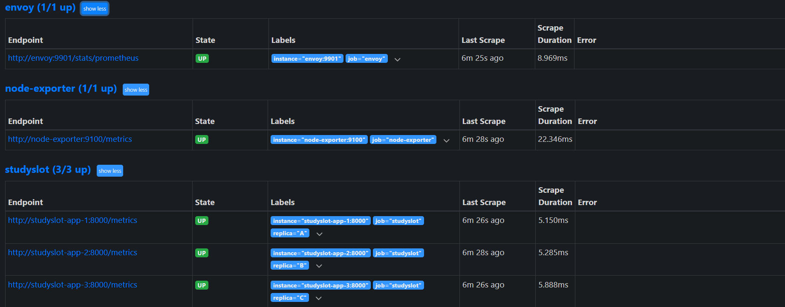

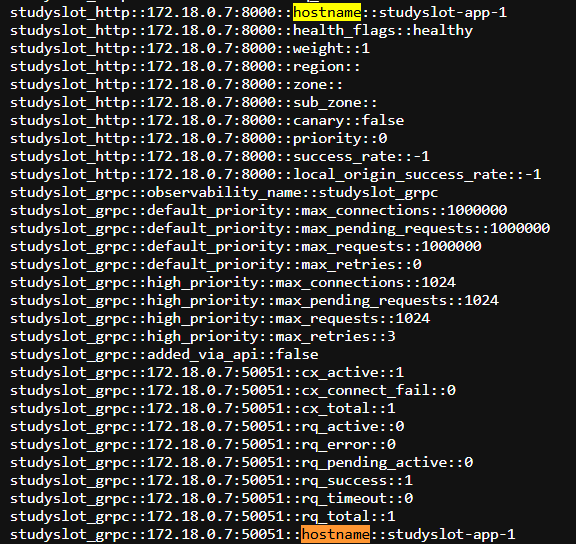

**Identity and correlation.** Scaled replicas share one environment, so each
replica asks Docker's DNS for its own container name at start-up
(`studyslot-app-2` → B). The letter goes on every log line (`replica`), on every
response (`X-Replica` header / `x-replica` metadata) and on
`studyslot_replica_info`. Prometheus adds a matching `replica` label per
target. Envoy forwards `traceparent` and `X-Request-ID` unchanged, so A2's trace
correlation still works. IDs stay out of metric labels.

**Test traffic.** HTTP: `GET /bookings/{id}` (read-only, not rate limited).
gRPC: `CreateBooking`, A2's only unary RPC, always with the same idempotency
key, so every call is a replay that writes nothing. That makes the gRPC
workload a duplicate-prevention test too.

### A.2 Shared state

| State | Where | Shared? | Effect of three replicas |
|---|---|---|---|
| Bookings | SQLite file on a Docker volume | **Shared** | `UNIQUE(room, slot)` still prevents double booking. *Caveat:* one write lock, so writes don't scale, and it only works on one Docker host. |
| Idempotency records | `idempotency_keys` table, same transaction as the booking | **Shared** | A retry on another replica gets the original booking. In C-rr, 3,600 replays split 1,200 / 1,200 / 1,200 all returned the same booking ID. |
| Rate-limit counters | Each process's memory | **Separate** | See below. |
| Chaos switches, metric counters | Each process's memory | Separate | Lets D.2 slow only B. `studyslot_rooms_occupied` reads the shared database, so it must be combined with `max`, not `sum`. |

With separate counters, `GET /availability`'s limit of 5 calls per 10 s
becomes about 15 under round robin. Under 2:1:1 weights it becomes uneven, and
`Retry-After` from one replica means nothing on the next. Worse, behind Envoy
every caller arrives from Envoy's address and would share one budget. That last
problem is fixed: the limiter now uses the last `X-Forwarded-For` entry, the one
Envoy appends. The rest needs a shared store such as Redis.

---

## Part B — Observe the baseline

### B.1 Dashboard and queries

Dashboard **StudySlot A3: load balancing**
([JSON](monitoring/grafana/provisioning/dashboards/studyslot-a3-load-balancing.json))
shows HTTP on the left and gRPC on the right. Prometheus scrapes
`studyslot-app-1/2/3:8000` and Envoy's admin port every 5 s, never through
Envoy. Every rate and percentile uses a **1-minute window**.

| Panel (per replica) | Query (HTTP; gRPC uses `grpc_server_*`) |
|---|---|
| Rate | `sum by (replica) (rate(http_requests_total{route="/bookings/{booking_id}"}[1m]))` |
| Share | that rate `/ ignoring(replica) group_left` the total; per run: `increase(...[$__range])` |
| Active requests | `avg_over_time(http_requests_in_flight{...}[1m])`, plus Envoy's `upstream_rq_active` |
| p50 / p95 | `histogram_quantile(0.95, sum by (le, replica) (rate(http_request_duration_seconds_bucket{...}[1m])))` |
| Errors by status | `rate(http_requests_total{..., status!~"2.."}[1m])`, plus Envoy's upstream 5xx |

Two limits of these numbers come up later:

- **Histogram resolution.** The buckets jump from 100 to 250 ms, so a replica
  that always takes ~218 ms is drawn as p50 175 ms and p95 ~240 ms.
- **`increase()` is an estimate.** It extrapolates to the edges of the range, so
  per-run shares can be off by about 1 % (49.6 % for an exact 50.0 %). The exact
  counts come from the client and from Envoy's log.

Request metrics skip `/health` (Week 1 lab rule), so Envoy's health checks are
not counted as traffic.

### B.2 Workload and baseline

`scripts/load_test.py` is open loop: request *i* leaves at *start + i/rate*
whether or not earlier ones have answered, so a slow replica cannot hide by
slowing the client. Every run sends **40 req/s per interface for 90 s (3,600
each)**, HTTP and gRPC at the same time. Each request gets one attempt with a
2 s timeout, gRPC uses one channel, and the client records which replica
answered and the trace ID. Runs were at least 60 s apart.

| A only | HTTP | gRPC |
|---|---|---|
| Target / actual rate | 40 / 39.99 req/s | 40 / 39.99 req/s |
| Sent / successes / failures | 3,600 / 3,600 / 0 | 3,600 / 3,600 / 0 |
| Client p50 / p95 | 11.8 / 19.7 ms | 12.6 / 21.0 ms |
| Server p50 / p95 (A) | 3.8 / ≈9 ms | 5.1 / ≈10 ms |
| Answered by | A 100 % | A 100 % |

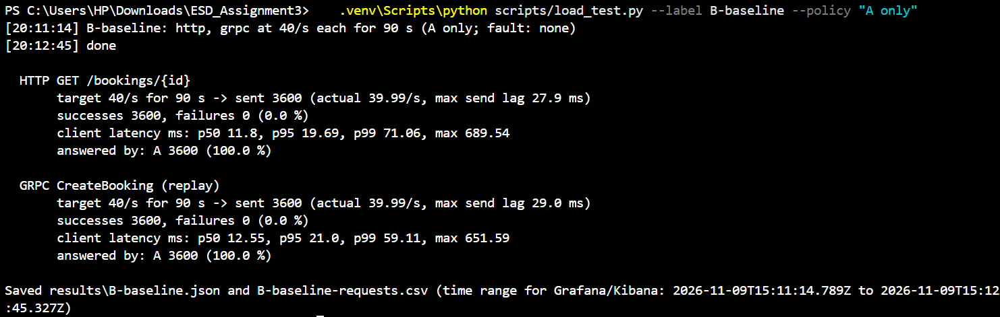

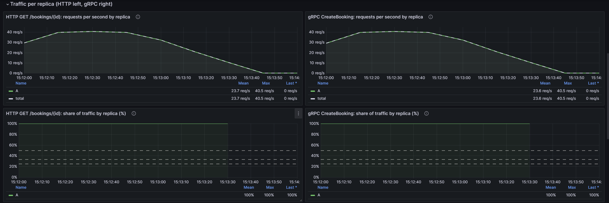

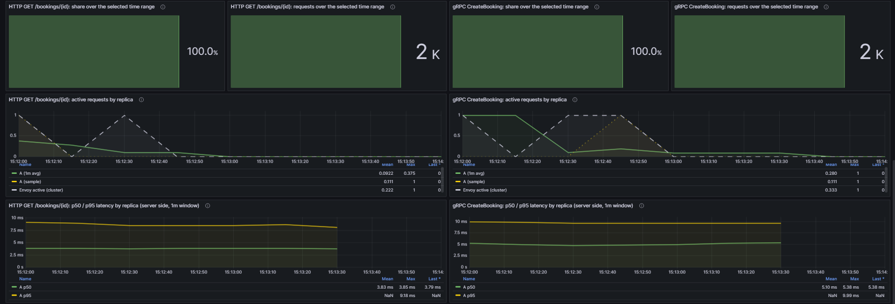

A did all the work while B and C idled. Most of the client's ~12 ms is spent
outside the replica: in Envoy, Docker Desktop's port forwarding and the client.

*Caveat:* in each run checked (B, C, D.1), 9–23 requests per interface took
over 0.3 s (max 0.75 s). They were all within one second, 11–15 s into the run,
on both interfaces at once. The client's send lag stayed under 70 ms, so the
stall was downstream of it, most likely in Docker Desktop's VM. It affects max
and p99, not p95.

### B.3 Proxy and backend logs

Envoy writes one JSON line per request. It records the replica that answered
(`replica`, from the replica's `X-Replica`), the container it picked
(`upstream.name`), `network.protocol`, `response_flags` and the trace headers.
Filebeat turns Envoy's `traceparent` into `trace.id`, the field the replicas
log, so one search per interface, `trace.id : "<id>"`, returns Envoy's event
together with the replica's:

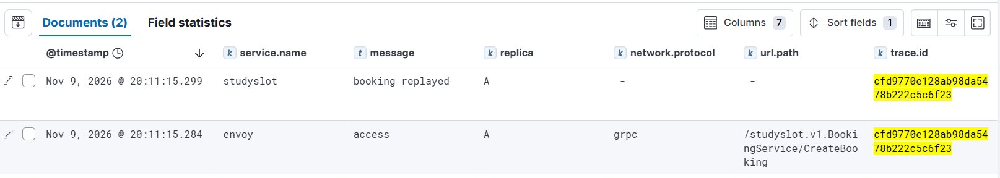

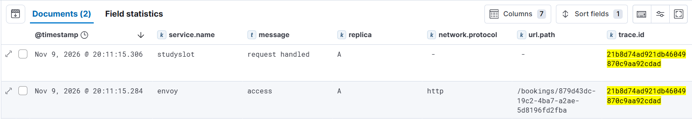

The replica's event is `booking replayed` for gRPC and `request handled` for
HTTP; the latter is a per-request log line added in A3. Envoy's timestamp is the
request's start, so it comes first.

---

## Part C — Enable load balancing

| Round robin | HTTP | gRPC |
|---|---|---|
| Sent / failures | 3,600 / 0 | 3,600 / 0 |
| A / B / C | 1,202 / 1,200 / 1,198 (33.4 / 33.3 / 33.3 %) | 1,200 / 1,200 / 1,200 (33.3 % each) |
| Client p95 | 16.6 ms | 17.8 ms |

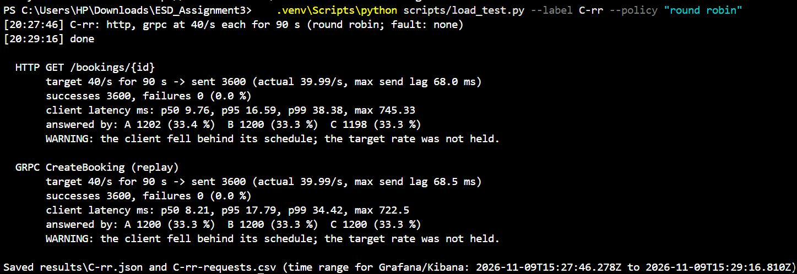

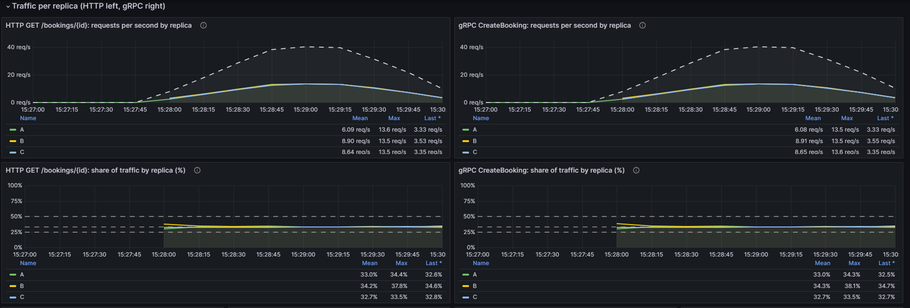

Each replica got a third, against 100 / 0 / 0 % in the baseline. Client p95
also fell a little (19.7 → 16.6 ms and 21.0 → 17.8 ms), probably because A no
longer serves all 80 req/s in one process.

**Why gRPC splits exactly and HTTP almost.** Envoy keeps a separate round-robin
position in each worker thread. The gRPC client's single connection is handled
by one worker, so its calls follow one rotation. The HTTP client opens several
connections spread across workers, each rotating on its own, so the totals land
within ±2. The dashboard's 1-minute share wobbles at first (B briefly 37.8 %)
while the window holds few requests, then settles at 33 %.

**Why the gRPC listener must be HTTP/2.** With the gRPC listener switched to a
plain TCP proxy (`rr-tcp-grpc`), **all 1,200 calls went to A**. A TCP proxy sees
only connections, so it chose once for the client's one connection. The HTTP/2
listener sees each call as a stream and routes each one, which is what
produced 1,200 / 1,200 / 1,200.

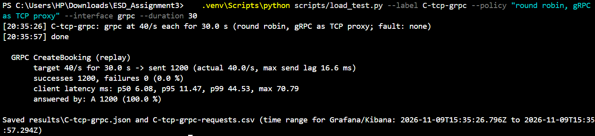

---

## Part D — Experiments

Each run started from healthy round robin with the same workload, and was put
back afterwards. Envoy retries, Envoy circuit breakers and client retries were
off.

### D.1 Weighted round robin, A:B:C = 2:1:1

**Prediction.** Shares of 50 / 25 / 25 %. A gets twice the requests but no extra
capacity. At ~3 ms per request its in-flight count stays near 0 (Little's law:
20/s × 0.003 s ≈ 0.06).

| | HTTP | gRPC |
|---|---|---|
| A / B / C | 1,799 / 901 / 900 (50.0 / 25.0 / 25.0 %) | 1,800 / 900 / 900 (50.0 / 25.0 / 25.0 %) |
| Client p95 of A's / B's / C's requests | 18.2 / 15.9 / 15.8 ms | 19.6 / 13.3 / 12.3 ms |
| Client p95 overall (C-rr) | 17.2 ms (16.6) | 18.4 ms (17.8) |

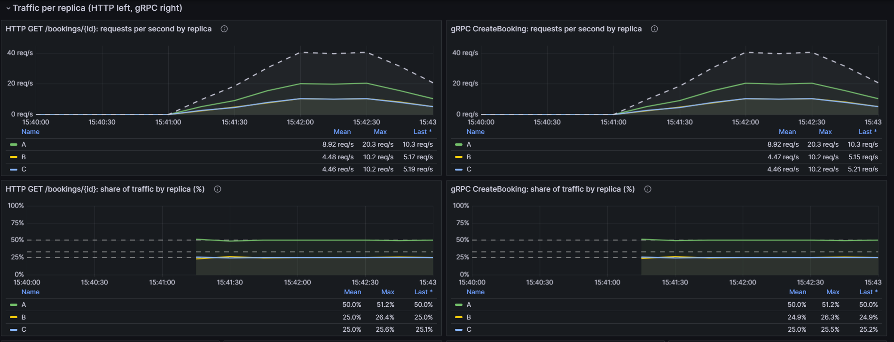

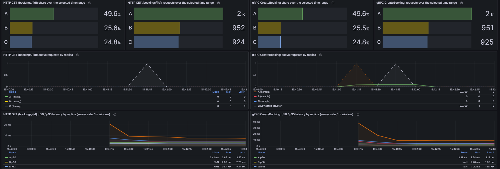

**Explanation.** The split was exact, and active requests stayed at ~0
everywhere. A's requests were slower at the tail because A did twice the work in
one process. The gap is wider for gRPC, probably because each replay also waits
for SQLite's write lock. At 40 req/s all replicas are far from their limit, so
the overall p95 barely moved. A weight decides who gets work, not how much a
replica can handle, so it only makes sense for a replica that really has more
capacity.

### D.2 Least request vs round robin, B delayed by 200 ms

B adds 200 ms to every API call on both interfaces. Both runs used the same
delay and workload.

**Prediction.** Round robin ignores speed, so B keeps a third. By Little's law
it then holds 13.3/s × 0.2 s ≈ 2.7 requests in flight, and with a third of
requests slow (more than 5 %), client p95 should be about 200 ms. Least request
picks two replicas at random and sends to the one with fewer active requests.
A and C finish in ~3 ms and are usually at 0, so B should lose most comparisons.
p95 only improves if B falls below 5 %.

| | RR, HTTP | LR, HTTP | RR, gRPC | LR, gRPC |
|---|---|---|---|---|
| B's share | 33.4 % | **15.1 %** | 33.3 % | **15.4 %** |
| A / C shares | 33.3 / 33.3 % | 43.2 / 41.7 % | 33.3 / 33.3 % | 41.3 / 43.3 % |
| B's active requests (1-min avg, peak) | 2.92 | 1.33 | ≈ 3 | ≈ 1.9 |
| Client p50 | 12.0 ms | 10.5 ms | 25.4 ms | 10.7 ms |
| Client p95 | 221.9 ms | 219.2 ms | 220.4 ms | 217.7 ms |

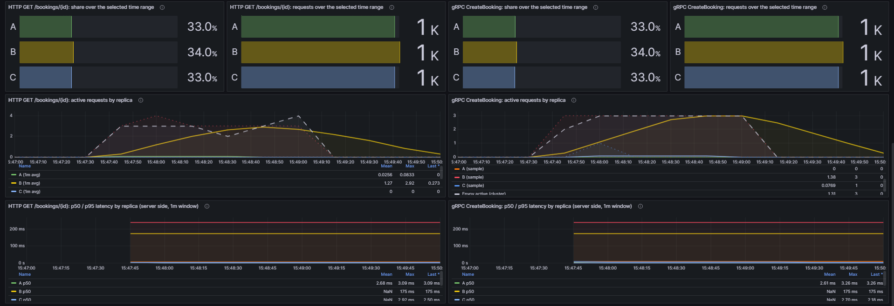

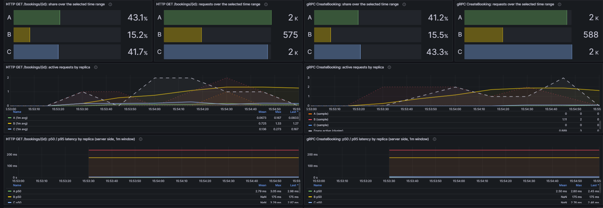

**Explanation.**

- **Least request shifted the load.** It moved about 18 percentage points away
  from B and halved B's queue. Little's law checks out: 543 requests in 90 s is
  6.0/s, and 6.0/s × 0.218 s ≈ 1.3.
- **B still got 15 %.** B is in the random pair two times out of three, and it
  wins only when it happens to have nothing in flight.
- **Client p95 did not move.** 15 % is still more than the 5 % that p95 looks
  past, so least request reduced how many requests were slow (33 % → 15 %), not
  how slow the slowest 5 % were.
- **Health checks would not help.** They were off in these runs, but B's
  `/health` is not delayed: a slow replica still passes a health check.
- *Caveat:* under round robin, C's gRPC calls were slow on the client side (p50
  25 ms) while C's server-side p50 stayed ~3 ms. That time was spent outside C,
  in Envoy or the client, and it did not recur under least request. It was not
  explained, so the gRPC p50 drop should not be credited to least request.

### D.3 Failure and recovery

**Health checks** (both clusters):

| Setting | Value |
|---|---|
| Check | HTTP `GET /health` → 200; gRPC `grpc.health.v1.Health/Check` → `SERVING` |
| Interval | 2 s (also before any traffic) |
| Timeout | 1 s |
| Unhealthy threshold | 2 failed checks in a row |
| Healthy threshold | 2 passed checks in a row |
| Panic threshold | 50 % (default); one of three down leaves 67 % healthy |

The client ran `docker stop studyslot-app-2` at 30 s and
`docker start studyslot-app-2` at 60 s itself, recording both times.

**Prediction.**
- **Removal:** after 2 failed checks, about 2–5 s depending on where in the 2 s
  cycle B stopped.
- **Errors meanwhile:** about 13.3/s × 4 s ≈ 50 per interface.
- **Recovery:** start-up (~1–2 s) plus 2 passed checks (2–4 s).

| | HTTP | gRPC |
|---|---|---|
| Failures | 55 × `503` (1.53 %) | 48 × `UNAVAILABLE` (1.33 %) |
| Errors ended after the stop | **4.1 s** | **3.9 s** |
| B answered again after the start | **5.6 s** | **12.6 s** |
| A / B / C over the run | 39.7 / 20.6 / 39.7 % | 41.0 / 18.0 / 41.0 % |
| Client p95 / p99 | 20.1 / 134.9 ms | 20.6 / 80.7 ms |

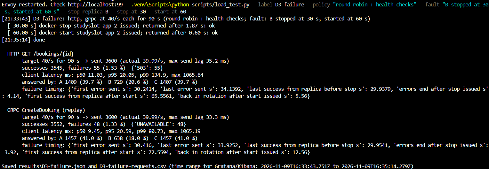

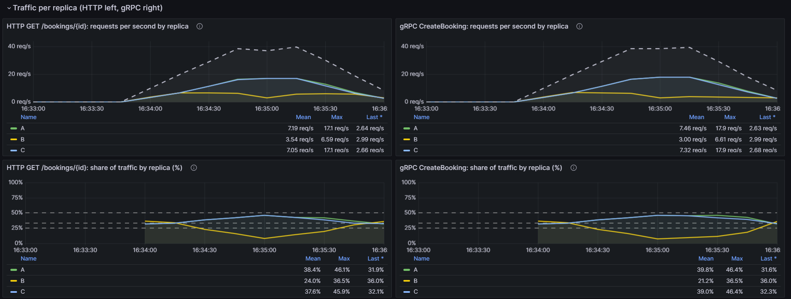

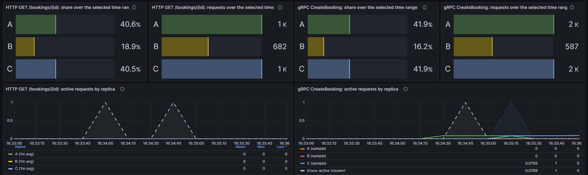

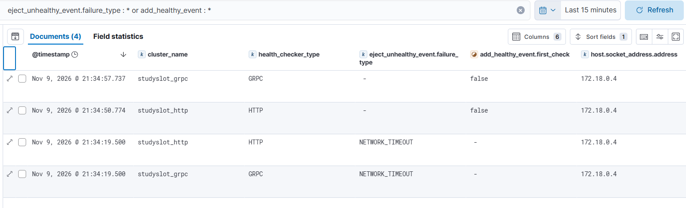

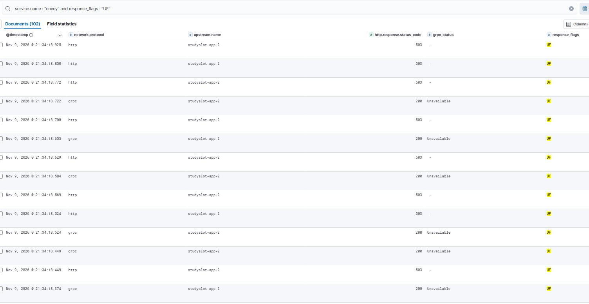

**Explanation.**

- **Removal matched the settings.** It took ~4 s, which is 2 failed checks × the
  2 s interval. Errors (55 and 48) matched the predicted ~50, and A and C took
  over B's share.
- **Envoy's logs agree.** Kibana shows both clusters removing B with
  `NETWORK_TIMEOUT`, and 102 of the 103 failures logged with flag `UF`
  (upstream connection failure), all to `studyslot-app-2`.
- **Later failures took ~1 s each.** Once the container had gone, its IP
  stopped answering, so attempts waited for Envoy's 1 s connect timeout. That is
  also why the health checks failed by timeout.
- **gRPC errors are invisible in HTTP status codes.** For gRPC, Envoy answered
  HTTP 200 with `grpc-status: Unavailable`.
- **p95 was unaffected.** 1.5 % failures is under 5 %; they show up in p99.
- **HTTP recovery fits the settings:** 5.6 s is start-up plus two passed checks.
- *Caveat:* gRPC recovered ~7 s later than that, although both checks reach the
  same process. The cause was not found. The likeliest suspect is how Envoy's
  gRPC health checker reconnects after timed-out checks.
- **The dashboard alone would have hidden this.** B was out for 35–42 s, less
  than the 1-minute window, so its rate never reached 0. It also counted fewer
  requests for B than the client did (682 vs 729 HTTP), most likely because
  counts since the last scrape were lost when the process stopped. The exact
  timing came from the client and Envoy's log.

### D.4 Summary of all runs

| Run / interface | Policy and fault | Target / actual req/s | A / B / C shares (%) | Client p95 | Error rate | Explanation |
|---|---|---|---|---|---|---|
| B-baseline / HTTP | A only | 40 / 39.99 | 100.0 / 0.0 / 0.0 | 19.7 ms | 0.0 % | Only A is a destination. |
| B-baseline / gRPC | A only | 40 / 39.99 | 100.0 / 0.0 / 0.0 | 21.0 ms | 0.0 % | Only A is a destination. |
| C-rr / HTTP | Round robin | 40 / 39.99 | 33.4 / 33.3 / 33.3 | 16.6 ms | 0.0 % | Per-worker rotations over several connections: ±2. |
| C-rr / gRPC | Round robin | 40 / 39.99 | 33.3 / 33.3 / 33.3 | 17.8 ms | 0.0 % | One connection, one worker: exact. |
| C-tcp-grpc / gRPC | Round robin, TCP proxy | 40 / 40.0 | 100.0 / 0.0 / 0.0 | 11.5 ms | 0.0 % | Layer 4 chooses once per connection. |
| D1 / HTTP | Weighted 2:1:1 | 40 / 40.0 | 50.0 / 25.0 / 25.0 | 17.2 ms | 0.0 % | Weights exact; A's tail slightly slower. |
| D1 / gRPC | Weighted 2:1:1 | 40 / 40.0 | 50.0 / 25.0 / 25.0 | 18.4 ms | 0.0 % | More work on A, not more capacity. |
| D2a / HTTP | Round robin; B +200 ms | 40 / 39.98 | 33.3 / 33.4 / 33.3 | 221.9 ms | 0.0 % | RR ignores speed; a third of requests slow. |
| D2a / gRPC | Round robin; B +200 ms | 40 / 39.98 | 33.3 / 33.3 / 33.3 | 220.4 ms | 0.0 % | Same. |
| D2b / HTTP | Least request; B +200 ms | 40 / 40.0 | 43.2 / 15.1 / 41.7 | 219.2 ms | 0.0 % | B's share and queue halved; 15 % > 5 %, so p95 unchanged. |
| D2b / gRPC | Least request; B +200 ms | 40 / 40.0 | 41.3 / 15.4 / 43.3 | 217.7 ms | 0.0 % | Same. |
| D3 / HTTP | RR + health checks; B stopped 30–60 s | 40 / 39.99 | 39.7 / 20.6 / 39.7 | 20.1 ms | 1.53 % | Removed after ~4 s (2 × 2 s); back after 5.6 s. |
| D3 / gRPC | RR + health checks; B stopped 30–60 s | 40 / 39.99 | 41.0 / 18.0 / 41.0 | 20.6 ms | 1.33 % | Removed after ~4 s; back after 12.6 s. |

**Check against Envoy's access logs.** For C-rr, `scripts/envoy_log_counts.py`
counted Envoy's own events in Elasticsearch over the same time range:

- **HTTP:** 3,600, split 1,202 / 1,200 / 1,198.
- **gRPC:** 3,600, split 1,200 each.

Both match the client exactly. The first attempt found 3,596, because the
client's times come from Windows and Envoy's from Docker's VM, and the two
clocks differ by a fraction of a second. A 2 s margin on the query fixed it.

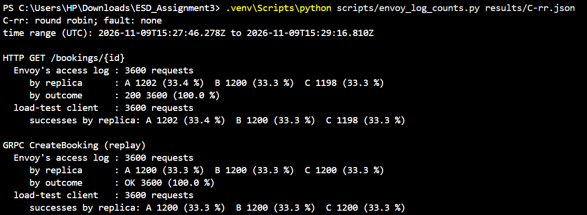

---

## Conclusions

**1. Strategy for HTTP and gRPC.** **Least request** for both, with active
health checks.

- With equal replicas (C-rr), round robin was already even; least request
  should be too, though that case was not measured.
- With one slow replica (D.2), least request moved 18 percentage points away
  from it and halved its queue at no cost to the others, while round robin kept
  sending it a third.
- For gRPC, per-call balancing is the first requirement: one client uses one
  long-lived connection, so the listener must be HTTP/2 (Part C). Counting
  active requests then suits gRPC well, since many calls share that connection.
- Health checks removed a stopped replica in ~4 s (D.3) but cannot catch a slow
  one. Pushing a slow replica below 5 % (to improve p95) would need passive
  outlier detection as well, which was not tested.

**2. A workload where I would choose differently.** If each replica cached
availability per room in memory, I would use **consistent hashing** on the room
ID, so each room's requests always land on the replica holding its cache.
Least request would spread them over three caches. (The optional
consistent-hashing experiment was not attempted.)

**3. If Envoy stops.** Envoy is a single point of failure: every request and
call would be refused although A, B and C are healthy. Prometheus would still
show the replicas **up**, because it scrapes them directly, so Envoy's own `up`
and client-side errors need alerts too. The improvement is to "load balance the
load balancer" (Lecture 13): two Envoys as an active–standby pair with
heartbeats and a floating IP that moves to the standby on failure. A smaller
step is a Docker restart policy on Envoy.

---

## References and reused work

- Course Lecture 13 (load balancing: static and dynamic algorithms, reverse proxies, active–standby load balancers with a floating IP).
- Course lecture notes on gRPC (HTTP/2 multiplexing over one connection) and metrics (histograms and quantiles).
- Course Week 1 lab (Midnight Launch): logging, tracing and metric conventions.
- Envoy documentation: load-balancing policies, health checking, access-log format.
- Assignments 1 and 2 (StudySlot) code, extended here.
- AI assistance: Some part of the code was written with the help of Claude.